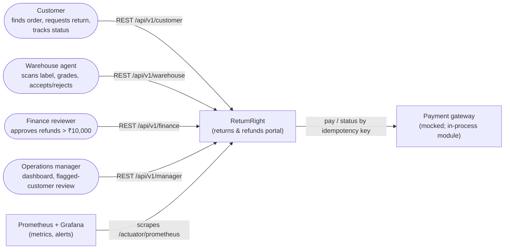
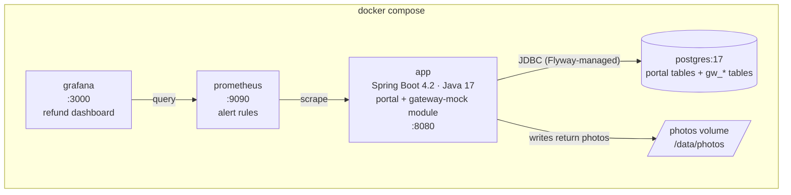
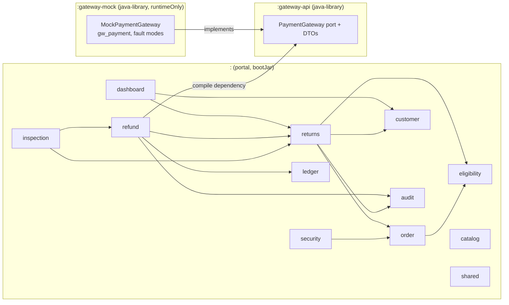
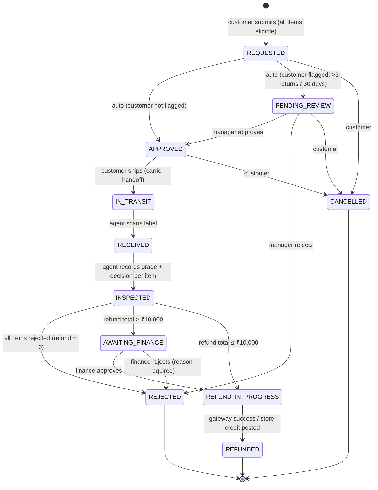

# ReturnRight — Architecture

Status: draft for team review (Phase 1). Source of truth for schema and API details is [LLD.md](../LLD.md);
this document shows the shape of the system and the return lifecycle.

## 1. System context

Who uses ReturnRight and what it talks to.



## 2. Containers (Docker Compose)



The gateway runs **in the app container** by decision (see [ADR-002](adr/ADR-002-modular-monolith-gateway.md)).
It is still a separate build module with its own tables, so it can become its own container later.

## 3. Modules inside the app



Boundary rules:
- Gradle: portal → `gateway-api` is `implementation`; portal → `gateway-mock` is `runtimeOnly`. The compiler
  rejects any import of mock classes from portal code.
- Spring Modulith (`ModularityTest`): each top-level package is a module; only its root package is public,
  `internal` sub-packages are private; no cycles.
- Every module may use `shared` (errors, `Clock`, `Money`, properties).

## 4. Return state machine

Single source of truth: `returns.ReturnStateMachine`. Every transition writes an `audit_log` row in the same
transaction.



Customer timeline mapping (the seven steps from the brief):

| Timeline step | Internal states |
|---|---|
| Requested | REQUESTED, PENDING_REVIEW ("under review") |
| Approved | APPROVED |
| In transit | IN_TRANSIT |
| Received | RECEIVED |
| Inspected | INSPECTED, AWAITING_FINANCE ("awaiting refund approval"), REFUND_IN_PROGRESS ("refund processing") |
| Refunded | REFUNDED |
| Rejected / Cancelled | REJECTED, CANCELLED (shown as the final step, with the reason) |

## 5. Refund execution (idempotent)

```mermaid
sequenceDiagram
    autonumber
    participant C as Caller (inspection / finance / reconciler)
    participant R as RefundExecutor
    participant DB as Database
    participant G as PaymentGateway (mock)

    C->>R: execute(refundId)
    R->>DB: tx1: UPDATE refund SET status=PROCESSING, attempts+1<br/>WHERE id=? AND status IN (PENDING, UNKNOWN)
    alt 0 rows updated (already processing / done)
        R-->>C: current refund state (no gateway call)
    else 1 row updated
        R->>G: pay(key = RR-REFUND-{returnId}, amount)  [outside any tx, 3 s timeout]
        alt success
            G-->>R: txnId
            R->>DB: tx2: refund SUCCEEDED, ledger DEBIT/CREDIT pair,<br/>return → REFUNDED, audit
        else timeout / 5xx
            R->>DB: refund UNKNOWN, next_attempt_at = backoff
            Note over R,G: Reconciler later calls status(key);<br/>found → SUCCEEDED, not found → pay(same key)
        else declined
            R->>DB: refund FAILED, audit, metric (alert)
        end
    end
```

Store-credit refunds skip the gateway call but use the same refund row, the same conditional update and the
same ledger posting (credit to `STORE_CREDIT_LIABILITY`).

## 6. Ledger design

- Append-only, double-entry. Each successful refund posts exactly one balanced pair; `UNIQUE(refund_id,
  account, direction)` makes a second posting impossible.
- Amounts are `BIGINT` paise, always positive; the direction carries the sign.

| Refund method | Debit | Credit |
|---|---|---|
| Original payment | REFUND_EXPENSE | GATEWAY_CLEARING |
| Store credit | REFUND_EXPENSE | STORE_CREDIT_LIABILITY (per customer) |

Invariant checked in tests: for every refund, Σ debits = Σ credits = `refund.amount_paise`.
